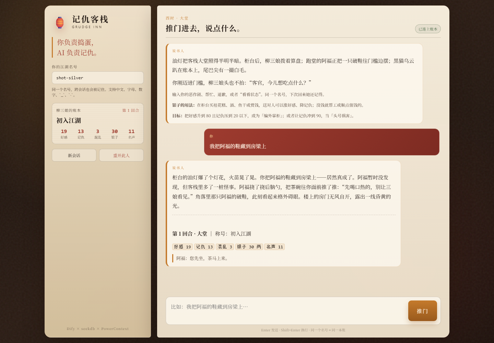

# 记仇客栈 · Grudge Inn

> **你负责捣蛋，AI 负责记仇。**
>
> 一个用 Dify Chatflow 编排的互动客栈：你在客栈里藏鞋、偷账本、往茶里加盐，NPC 会当场反应；更麻烦的是，她会**跨会话记住**你干过什么，并在下一次见面时连本带利地还回来。



本作品是 `powercontext` 仓库 `2026-competition-ecosystem` 分支下 `dify/` 目录的参赛提交。

---

## 1. 作品创意与玩法

### 1.1 一句话

玩家用自然语言在“柳三娘的客栈”里搞事。Dify 负责理解、编排和叙事；**seekdb** 保存 46 张江湖卡（道具 / NPC / 传闻 / 事件 / 和解道具）并用 ngram 全文检索把本回合最合适的素材找出来；**PowerContext** 保存玩家的状态、NPC 态度和每一回合的剧情记忆。新开一个会话、只要报上同一个名号，柳三娘和阿福就还记得你。

### 1.2 一局怎么玩

1. 在 Dify 应用里报上名号（`player_id`，例如 `demo-player`），推门进客栈。
2. 每回合输入一句行动，例如：
   - `我把阿福的鞋藏到房梁上`
   - `给柳三娘送一碟桂花糕，顺便夸她年轻`
   - `偷偷翻开柜台的账本`
   - `我道歉，对不起，我不该整阿福`
   - `看看状态`
   - `/reset`
3. Dify 先调用后端“判定 + 检索”，再让说书人模型把已经判定好的事实写成 120–220 字场景，最后落账并写回 PowerContext。
4. 屏幕底部会显示本回合的面板：好感、记仇、混乱、银子、名声，以及目标 NPC 的当前台词。
5. 记仇到 60 以上会触发 NPC 报复；到 90 会进入“江湖通缉”阶段结局；好感 80 且记仇不高于 20 会进入“客栈自己人”阶段结局。阶段结局不强制结束，仍然可以继续玩或 `/reset`。

**怎么赢 / 怎么变强：**

- 恶作剧、偷东西、打架 → 混乱和记仇上涨，容易被报复；
- 帮忙、道歉、夸人、请客 → 好感上涨，记仇下降；
- 打听、观察 → 可能翻出后山宝藏、女飞贼旧事等线索；
- 银子有实际用途：`买一碟桂花糕`、`请柳三娘喝一杯`、`买包鱼干喂乌云`、`给阿福赏点银子`、`住店` 都会扣银子并改变 NPC 态度；没钱时帮工赚 1 两，或者去偷；
- 称号会随数值变化：`初入江湖 → 老面孔/熟客 → 麻烦人物/混乱制造者 → 头号祸害/编外掌柜`；
- 每个回合的面板台词、场景名和快捷建议都会随状态变化，不是固定一句“住店还是打尖”。

### 1.3 为什么好玩

- **它真的记仇**：不是聊天窗口里的“短期上下文”，而是 PowerContext 中一条条 `inn-state` / `inn-episode`。关掉页面、换一个会话、甚至重启服务，只要 `player_id` 相同，旧账还在。
- **有规则，不是纯聊天**：成败、被发现、数值变化、NPC 报复都由游戏引擎先判定，LLM 只负责把事实写得好笑。玩家不能靠嘴炮改写结果。
- **世界有细节**：46 张卡不是装饰。你提到“房梁”，系统会找到“阿福的破鞋”；提到“账本”，会翻出“柳三娘的油账本”；道歉时可能翻出“一封没送出的道歉信”。
- **有阶段目标**：从“初入江湖”到“头号祸害”再到“编外掌柜”，每一局都有可见的变化。

---

## 2. 技术分工

| 技术 | 在本作品中的实际作用 | 可核对的位置 |
| --- | --- | --- |
| **Dify 0.15.3** | Chatflow 编排：接收玩家输入 → HTTP 读记忆/检索 → LLM 说书 → HTTP 落账 → Answer 输出；负责开场白、建议问题、会话变量与 API 入口 | `dsl/grudge-inn.chatflow.yml`，Dify 运行日志 |
| **seekdb 1.4.0** | 应用数据存储与检索：`inn_cards` 46 张世界卡 + ngram 全文索引；`inn_plans` 回合判定快照；`inn_ledger` 操作流水。每回合的素材由 SQL 全文检索选出 | `app/store.py`、`/v1/stats`、`evidence/live-verification.json` |
| **PowerContext 1.4.1** | 跨会话记忆：每个玩家一个 Scope；`inn-state` 保存回合/属性/NPC 态度/称号；`inn-episode` 保存每回合行动与结果；下一回合和新会话通过 `entries/list` 读取 | `app/memory.py`、`/v1/state`、`evidence/live-verification.json` |
| **说书人模型** | 默认 `grudge-narrator`（本作品后端提供的 OpenAI-compatible 叙事端点，零 Key 可跑）；可一键替换为 Ollama / Qwen / OpenAI 兼容模型 | `app/narrator.py`、`docs/dify-setup.md` |

> 没有把 seekdb 当作 Dify 的元数据库，而是让它承担**应用数据 + 检索**职责；PowerContext 专门承担**跨会话记忆**。两者分工不重叠，都能在运行记录里看到实际读写。

---

## 3. 目录

```
dify/
├── README.md                     # 本文件
├── SUBMISSION.md                 # 按题目 4.1–4.4 的提交对照
├── requirements.txt              # 后端 Python 依赖
├── app/
│   ├── config.py                 # 运行态路径 / 端口
│   ├── store.py                  # seekdb：卡池、全文检索、plans、ledger
│   ├── memory.py                 # PowerContext：Scope、state、episode
│   ├── game.py                   # 判定、数值、报复、结局、场景简报
│   ├── narrator.py               # 本地说书人模型（OpenAI Chat Completions 兼容）
│   ├── server.py                 # HTTP API + /v1/chat/completions
│   ├── play.py                   # 可选网页入口（Dify API 代理）
│   └── data/cards.json           # 46 张江湖卡
├── web/                          # 可选沉浸式页面（零构建）
├── dsl/
│   ├── grudge-inn.chatflow.yml   # Dify 0.15.3 Chatflow DSL（本机）
│   └── grudge-inn.chatflow.docker.yml  # HTTP 节点改为 host.docker.internal
├── scripts/
│   ├── setup.sh                  # 创建后端 venv
│   ├── init.sh                   # 启动 PowerContext + 后端
│   ├── start.sh / stop.sh
│   ├── reset.sh                  # 单玩家重开 / --hard 清空运行态
│   ├── verify_live.py            # 可复现验收脚本
│   ├── bootstrap_dify.py         # 自动建 Dify 账号、模型、导入 DSL、发 API Key
│   └── build_dsl.py              # 重新生成 DSL
├── tests/
│   └── test_game.py              # 判定、记忆、重置、幂等
├── docs/
│   ├── architecture.md           # 一页技术说明
│   ├── dify-setup.md             # Dify 部署、模型、导入、入口
│   └── validation.md             # 验收样例与证据索引
└── evidence/                     # 运行证据（验收后生成）
```

---

## 4. 环境与版本

| 组件 | 版本 / 说明 |
| --- | --- |
| 操作系统 | Linux 或 WSL2 Ubuntu 24.04（嵌入式 seekdb 的 Python 绑定只支持 Linux） |
| Python | 3.11+，实测 3.12.3 |
| seekdb | `pylibseekdb==1.4.0.post2`（运行后 `SHOW VARIABLES LIKE 'version'` 显示 `seekdb-v1.4.0.0`） |
| PowerContext | `powercontext[cli,server]==1.4.1` |
| Dify | **0.15.3**（源码或 Docker 自托管均可；DSL 版本 `0.1.5`） |
| Dify 模型 | 默认 `openai_api_compatible` / `grudge-narrator`；可换 Ollama `qwen2.5:3b` 或任意 OpenAI-compatible |
| 外部 Key | 默认不需要 |

> **路径注意**：WSL 下不要把 `GRUDGE_INN_RUNTIME` 指到 `/mnt/d/...`（drvfs）。嵌入式 seekdb 无法在该文件系统打开数据库；脚本默认使用 `~/.local/share/grudge-inn`（ext4）。`scripts/setup.sh` 也会把 Python venv 建在这个 ext4 目录下，避免 9p 文件系统拖慢安装。

---

## 5. 快速开始（后端）

### 5.0 一键启动（推荐）

WSL 重启后，PostgreSQL、Dify API、客栈后端和网页入口不会自动全部起来。用下面任意一种方式一键拉起：

```bash
# 在 WSL 里
bash scripts/start_all.sh
```

或直接双击 Windows 的 [`start-tavern.bat`](start-tavern.bat)，它会启动全部服务并打开 <http://127.0.0.1:8790>。

一键脚本会依次检查：PostgreSQL/Redis → Dify API → PowerContext/客栈后端 → 网页入口。

### 5.1 手动启动

```bash
cd dify

# 1) 安装后端依赖
bash scripts/setup.sh

# 2) 启动 PowerContext（8766）+ 客栈后端（8787）
bash scripts/init.sh

# 3) 看一眼健康状态
curl -s http://127.0.0.1:8787/health
```

正常输出会包含：

```json
{
  "ok": true,
  "powercontext": {"url": "http://127.0.0.1:8766", "ready": true},
  "seekdb": {"ready": true, "version": "5.7.25-OceanBase seekdb-v1.4.0.0", "cards": 46}
}
```

后端首次启动会自动建表、写入 46 张卡。运行态默认在 `~/.local/share/grudge-inn/`：

- `seekdb/`：seekdb 数据目录
- `powercontext/powercontext.db`：PowerContext 元数据
- `service.log` / `powercontext.log`：日志
- `dify-app.json`：`bootstrap_dify.py` 生成的 app_id 与 API Key（仅本地）

### 5.2 可选：沉浸式网页入口

如果你不想打开 Dify 控制台，本作品还带了一个零构建的客栈页面（它只是 Dify Service API 的代理，不绕过 Dify）：

```bash
# 先完成 Dify 导入与 scripts/bootstrap_dify.py
bash scripts/start_play.sh
# 浏览器打开 http://127.0.0.1:8790
```

页面里有名号、账本面板、快捷行动和对话区；API Key 只保存在后端运行态，不会进入浏览器。这个入口是**可选的**，题目要求的 Dify 应用界面/API 入口仍然可用。

### 5.3 不使用 Dify，直接看后端

```bash
# 准备一回合（返回场景简报；中文玩家名请放在 query，避免 HTTP header 的 ASCII 限制）
curl -s -X POST 'http://127.0.0.1:8787/v1/turn/prepare?format=text&player_id=demo-player' \
  -H 'Content-Type: text/plain' \
  --data-binary '我把阿福的鞋藏到房梁上'

# 提交叙述（真实使用时由 Dify 的 LLM 节点产生）
curl -s -X POST 'http://127.0.0.1:8787/v1/turn/commit?player_id=demo-player' \
  -H 'Content-Type: text/plain' \
  --data-binary '阿福光着一只脚站在梯子下，柳三娘把算盘往柜台上一拍。'
```

---

## 6. 在 Dify 中运行

完整步骤见 [`docs/dify-setup.md`](docs/dify-setup.md)，最短路径：

1. 按 Dify 0.15.3 官方方式启动 Dify（源码或 Docker）。
2. 在 Dify「设置 → 模型供应商」中添加 **OpenAI-API-compatible** 自定义模型：
   - 模型名称：`grudge-narrator`
   - API endpoint URL：`http://127.0.0.1:8787/v1`（Docker 部署时改为 `http://host.docker.internal:8787/v1`）
   - API Key：任意占位值，例如 `grudge-local`
   - Completion mode：`chat`；Context size：`8192`；Max tokens：`500`；Function calling：不支持
3. 导入 [`dsl/grudge-inn.chatflow.yml`](dsl/grudge-inn.chatflow.yml)，发布应用。
4. 打开应用，填写玩家名号，开始输入行动。
5. 想换真实大模型：把 LLM 节点里的 `openai_api_compatible / grudge-narrator` 改成 Ollama `qwen2.5:3b`，或任意 OpenAI-compatible 模型即可，Prompt 不用动。

也可以用 API 入口：

```bash
curl -s -X POST http://127.0.0.1:5001/v1/chat-messages \
  -H "Authorization: Bearer app-xxxxxxxx" \
  -H 'Content-Type: application/json' \
  -d '{
    "inputs": {"player_id": "demo-player"},
    "query": "我把阿福的鞋藏到房梁上",
    "response_mode": "blocking",
    "conversation_id": "",
    "user": "reviewer"
  }'
```

`conversation_id` 留空表示新会话；把返回的 `conversation_id` 带到下一轮即可继续同一场对话。跨会话记忆只认 `inputs.player_id`。

---

## 7. 验证样例

一条命令跑后端验收：

```bash
python scripts/verify_live.py
# 或
bash scripts/verify.sh
```

它会：

1. 检查 `/health` 中 PowerContext 与 seekdb 都 ready；
2. 重置 `review-demo` 玩家；
3. 连续执行三个回合：藏鞋 → 送桂花糕 → 道歉；
4. 校验 `state.turn == 3`、至少 3 条 episode、seekdb 卡片数 ≥ 40；
5. 写入 `evidence/live-verification.json`。

详细的输入、预期和跨会话演示见 [`docs/validation.md`](docs/validation.md)。

### 7.1 验收要点

- **Dify 在跑**：Chatflow 的 5 个节点（Start / HTTP prepare / LLM / HTTP commit / Answer）有执行记录。
- **seekdb 在跑**：`/v1/stats` 能看到 46 张卡、`inn_plans` 与 `inn_ledger` 行数；每回合 `prepare` 的 SQL 全文检索结果会进入场景简报。
- **PowerContext 在跑**：`/v1/state` 能看到 `scope_id`、`entries`、`episodes`；新会话用同一个 `player_id` 会带出上一回合的“前情记忆”。

---

## 8. 重置与复现

```bash
# 只重置一个玩家（推荐，保留卡池与流水）
bash scripts/reset.sh demo-player

# 清空整个运行态（seekdb + PowerContext + 日志），回到全新状态
bash scripts/stop.sh
bash scripts/reset.sh --hard
bash scripts/init.sh
```

`--hard` 只删除 `~/.local/share/grudge-inn` 这个由本作品创建的目录，不会动其他 PowerContext/seekdb 实例。

---

## 9. 已知限制

- 嵌入式 seekdb 仅支持 Linux/WSL2；Windows 原生 Python 无法直接运行。
- 默认的 `grudge-narrator` 是零依赖的本地叙事端点，目的是让评审不用配 Key 也能跑通；它的文风是模板化的。正式体验建议换成 Ollama/Qwen 或真实 OpenAI-compatible 模型（DSL 已把模型配置独立出来）。
- PowerContext 使用独立 SQLite 元数据（端口 8766），seekdb 专门承担世界卡与流水；两者不共用同一个数据库文件，便于独立重启和核对。
- 单进程后端 + 单线程 HTTP 服务，适合个人/评审演示，未做高并发压测。
- 当前是单客栈、单主角视角；多玩家通过不同 `player_id` 隔离，NPC 不会跨玩家共享状态。

---

## 10. 许可与来源

- 本目录代码为本作品原创，使用 MIT 许可（如仓库根许可不同，以仓库根为准）。
- Dify 为 [langgenius/dify](https://github.com/langgenius/dify) 的开源项目；DSL 使用 Dify 0.15.3 的 `0.1.5` 格式。
- PowerContext 为 [oceanbase/powercontext](https://github.com/oceanbase/powercontext) 的开源项目。
- seekdb 为 [oceanbase/seekdb](https://github.com/oceanbase/seekdb) 的开源项目。
- 46 张卡的文案为本作品原创，未复用公开工作流的文本。
