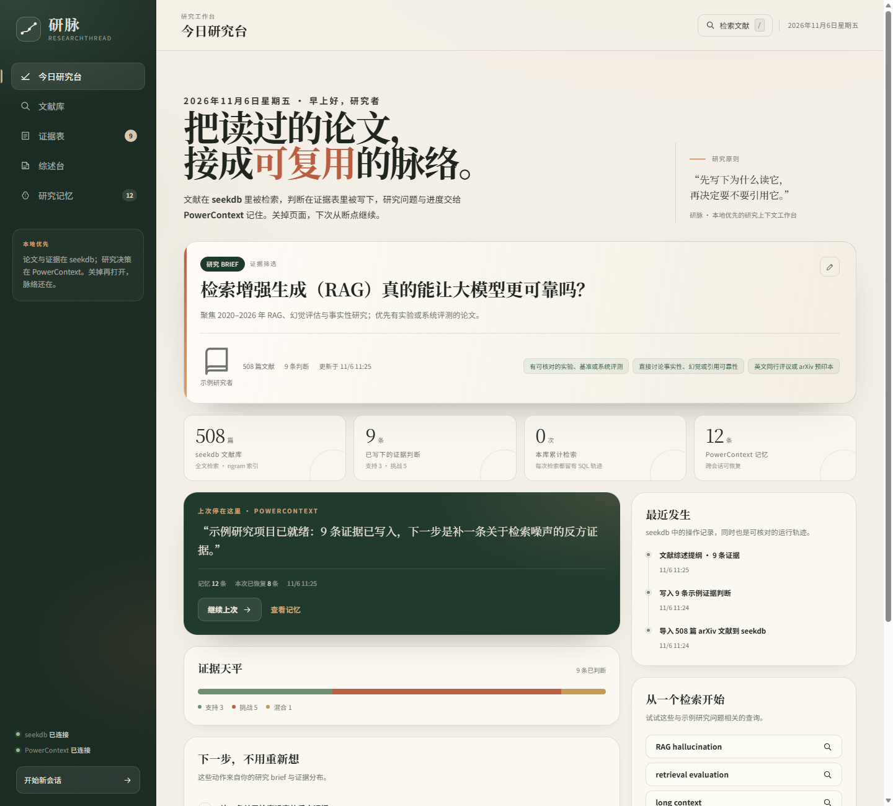

# 研脉 · ResearchThread

> 把散落的论文，接成可复用的研究脉络。

研脉是一个**本地优先的科研阅读与证据工作台**：用 **seekdb** 检索文献、保存证据判断，用 **PowerContext** 记住研究问题、筛选标准、判断理由与会话进度。它不是“再做一个聊天框”，而是把「检索 → 判断 → 综述 → 下次继续」做成一条可核对的研究闭环。

- 项目目录：[`qoder/`](.)（OceanBase × Qoder 赛道，资产放在 `2026-competition-ecosystem` 的 `qoder/` 目录）
- 示例研究问题：检索增强生成（RAG）真的能让大模型更可靠吗？
- 示例语料：508 篇 arXiv 摘要（RAG / LLM Agent / 幻觉与事实性 / AI for Science / 文献综述自动化）
- 运行方式：一条命令启动；首次启动自动初始化 seekdb、PowerContext、示例证据
- 生成方式：综述提纲由**规则模板**基于证据表生成，不依赖外部大模型，评审可离线复跑



## 1. 它解决什么问题

读文献时，真正重复且耗时的不是“读”，而是：

1. 读完一篇论文，过两周忘了**为什么当时觉得它重要**；
2. 综述写到一半，找不到某条判断对应的**论文与摘要出处**；
3. 换一台电脑、换一个会话，之前的研究范围、排除标准、下一步**全部要重建**；
4. 周报/组会汇报要从聊天记录和 PDF 里一条条拼。

研脉把这些动作固定成一条闭链：

```
研究 brief  →  seekdb 检索  →  证据判断（支持/挑战/混合）
     ↑                                      ↓
PowerContext 记忆  ←  会话交接  ←  综述提纲 / 组会周报
```

## 2. 核心功能

| 功能 | 说明 | 指定技术 |
| --- | --- | --- |
| 研究 brief | 研究问题、范围、纳入标准、阶段、下一步 | PowerContext `research-brief` |
| 文献检索 | 508 篇 arXiv 摘要，全文检索 + 标题/词法核验 + 年份/主题筛选 | seekdb `FULLTEXT INDEX ... WITH PARSER ngram` |
| SQL 轨迹 | 每次检索展示实际执行的 SQL、候选数、核验数、耗时 | seekdb `search_log` |
| 证据表 | 每条判断关联论文、stance、理由、更新时间；支持编辑/移除/导出 | seekdb `evidence` |
| 综述台 | 文献综述提纲 / 组会周报，带引用编号与参考列表，可复制/下载 | 规则模板 + seekdb `syntheses` |
| 研究记忆 | 记忆时间线、按类型筛选、原始 artifact 查看、重连 | PowerContext `atomic-memory` |
| 会话交接 | “开始新会话”先写入交接摘要，再从记忆恢复 | PowerContext `session-summary` |
| 降级不丢数据 | PowerContext 不可用时仍可检索和写 seekdb 证据，恢复后重连 | seekdb 为事实源 |

### 两个技术怎么分工

- **seekdb 是事实源**：论文、摘要、全文索引、证据判断、综述草稿、检索日志都在 seekdb。即使 PowerContext 暂时不可用，证据也不会丢。
- **PowerContext 是决策记忆**：研究 brief、每条证据判断的摘要、综述生成事件、会话交接。它不复制论文正文，只保存“为什么”和“停在哪里”。
- 两者不共用同一个数据库文件；PowerContext 使用独立 SQLite 元数据，seekdb 使用自己的数据目录，便于分别重启与核对。

## 3. 快速开始

### Windows（推荐 Python 3.12）

```powershell
cd qoder
powershell -ExecutionPolicy Bypass -File scripts\setup.ps1
powershell -ExecutionPolicy Bypass -File scripts\run.ps1
```

打开 <http://127.0.0.1:8787>。

`run.ps1` 会：

1. 把运行时数据放到 `%USERPROFILE%\ResearchThread`（避免中文路径影响 seekdb 原生二进制）；
2. 首次启动 seekdb 服务（端口 `18881`，可用 `RT_SEEKDB_PORT` 修改）；
3. 启动 PowerContext Server（端口 `18765`，可用 `RT_PC_PORT` 修改）；
4. 播种 508 篇文献、9 条示例证据，并写入 11 条初始记忆；
5. 启动 FastAPI Web 应用（端口 `8787`，可用 `RT_PORT` 修改）。

> seekdb 在 Windows 上以服务端模式运行（`seekdb.exe` + MySQL 协议）。绑定端口必须避开 Windows 的 excluded port range；`18881` 默认不在其中。可用 `netsh interface ipv4 show excludedportrange protocol=tcp` 检查。

### Linux / macOS

```bash
cd qoder
bash scripts/setup.sh
bash scripts/run.sh
```

Linux/macOS 走 `pylibseekdb` 嵌入式模式；PowerContext 仍为独立 Server。若端口冲突，设置 `RT_PORT` / `RT_PC_PORT`。

### 手动启动（便于排查）

```powershell
$env:RT_RUNTIME="C:\Users\you\ResearchThread"
$env:RT_PORT="8787"
.\.venv\Scripts\python.exe -m app
```

设置 `RT_AUTOSTART=0` 可关闭 seekdb / PowerContext 自动拉起，由你分别启动它们。

### 重置示例数据

```powershell
powershell -ExecutionPolicy Bypass -File scripts\reset.ps1
```

会删除运行时目录（seekdb 数据、PowerContext SQLite、scope、日志），下次启动重新播种。代码与 `data/` 不受影响。

## 4. 验证样例（评审可按步骤复跑）

前置：应用已启动，浏览器能打开 `http://127.0.0.1:8787`。

### 4.1 一条命令验收

```powershell
.\.venv\Scripts\python.exe scripts\verify.py
```

预期输出（节选）：

```
[PASS] seekdb 可用且已播种 — papers=508
[PASS] PowerContext 可用
[PASS] 全文检索命中 — total=35
[PASS] 检索结果由 seekdb 驱动 — seekdb FULLTEXT ngram + lexical verification
[PASS] 相关度排序把 RAGTruth 放在前列
[PASS] 证据写入 seekdb
[PASS] 综述包含「## 3. 支持证据」
[PASS] 综述写入 PowerContext
[PASS] 记忆数量增加 — 13 -> 14
```

> 数值随初始状态变化（示例库初始为 11 条记忆；新增一条证据、一份综述、一次交接后为 14 条）。

脚本会实际新增一条证据、生成一份综述、创建一个新会话；这是有意的验收副作用。需要回到初始状态时运行 `scripts\reset.ps1`。

### 4.2 手工验证路径

1. **首次打开**：今日研究台显示研究问题、508 篇文献、9 条证据、12 条记忆；侧栏 seekdb / PowerContext 均为已连接。
2. **检索**：进入「文献库」，输入 `RAG hallucination`，应看到 35 条结果，首条为 *RAGTruth: A Hallucination Corpus for Developing Trustworthy Retrieval-Augmented Language Models*；点「查看 SQL 轨迹」，能看到 `MATCH(title, abstract) AGAINST (...)`。
3. **判断**：点任意论文「加入证据表」，选择「挑战」，写一句判断并保存；证据表数量 +1，PowerContext 记忆数量 +1。
4. **综述**：进入「综述台」，保留默认「文献综述提纲」，点「生成」；右侧出现带 `[1]…[n]` 引用编号的 Markdown，参考列表与证据表一一对应。
5. **记忆**：进入「研究记忆」，能看到 `research-brief`、9+ 条 `evidence-decision`、`synthesis`、`session-summary`；点「查看原始记录」能看到 artifact JSON。
6. **跨会话**：点「开始新会话」→ 产生交接摘要 → 今日研究台恢复 brief 与记忆；刷新页面后仍在。

### 4.3 验证材料

- 集成验收脚本：[`scripts/verify.py`](scripts/verify.py)
- 单元测试：`python -m pytest`
- 真实运行截图：[`site/assets/`](site/assets/)
- 数据来源与许可：[`data/README.md`](data/README.md)

## 5. 架构

```
┌──────────────────────────────────────────────────────────────┐
│  Browser SPA (app/static)                                    │
│  今日研究台 · 文献库 · 证据表 · 综述台 · 研究记忆             │
└──────────────────────────────┬───────────────────────────────┘
                               │ JSON API
┌──────────────────────────────▼───────────────────────────────┐
│  FastAPI (app/main.py)                                       │
│  bootstrap / search / evidence / synthesis / memory / session│
└───────────────┬──────────────────────────────┬───────────────┘
                │ SQL over MySQL protocol      │ HTTP
┌───────────────▼──────────────┐  ┌────────────▼───────────────┐
│  seekdb                      │  │  PowerContext Server       │
│  papers / evidence /         │  │  Scope + atomic-memory     │
│  syntheses / search_log /    │  │  research-brief /          │
│  activity                    │  │  evidence-decision /       │
│  FULLTEXT ngram index        │  │  synthesis / session-summary│
└──────────────────────────────┘  └────────────────────────────┘
```

关键文件：

| 文件 | 作用 |
| --- | --- |
| `app/main.py` | FastAPI 路由、启动播种、会话与幂等记忆写入 |
| `app/seekdb.py` | seekdb 生命周期（Windows server / Linux embedded）、schema、检索、证据、统计 |
| `app/memory.py` | PowerContext Server 生命周期、Scope、Memory 读写、会话摘要 |
| `app/synthesis.py` | 规则化综述/周报生成，引用编号与参考列表 |
| `app/static/` | 单页应用（原生 JS/CSS，无构建步骤） |
| `data/papers.json` | 508 篇 arXiv 元数据快照 |
| `data/demo.json` | 示例 brief + 9 条证据判断 |
| `scripts/build_dataset.py` | 从 `data/raw/*.xml` 重建示例库 |
| `scripts/verify.py` | 端到端验收 |

## 6. 数据与许可

- 论文标题、摘要、作者、年份、venue 来自公开 **arXiv API** 快照；原始论文版权归作者所有。仓库只保存元数据/摘要用于检索演示，并在 UI/参考列表中给出 arXiv 链接。
- 数据集快照与重建脚本见 [`data/README.md`](data/README.md)；重新抓取请遵守 arXiv API 的使用条款与速率限制。
- 本项目代码以 [MIT 许可](LICENSE) 发布（如无特殊说明）；PowerContext、seekdb 遵循各自仓库许可。

## 7. 已知限制

- 示例库是 **arXiv 英文摘要**，不是全文学术库；检索质量受摘要长度与 ngram 解析限制。
- 综述由规则模板生成，不含大模型润色；优势是离线、可复现、引用可核对，劣势是语言不如模型自然。
- 当前是单用户、单 Scope 的本地应用；未做多租户、并发压力测试。
- Windows 上 seekdb 以服务端模式运行，需要避开 excluded port range；运行时默认放在用户目录，避免中文路径。
- PowerContext 的摘要型记忆依赖显式写入；没有配置生成模型时不会自动抽取长对话记忆。

## 8. Qoder 开发记录（提交前必读）

本仓库包含可运行代码、运行说明、验证样例和开发任务清单。赛道要求“主要开发工作必须在 Qoder 中完成”，因此提交前必须：

1. 在 Qoder（Desktop / IDE / CLI）中打开本目录；
2. 按 [`docs/qoder-prompts.md`](docs/qoder-prompts.md) 完成至少 3 个关键开发/修复任务，保留真实对话截图；
3. 把截图、Qoder 账号 UID、修改文件、验证输出填入 [`docs/qoder-development-log.md`](docs/qoder-development-log.md)；
4. 通过 Qoder Sites 发布 [`site/`](site/) 并设置「任何人都可访问」，把 URL 填入 [`docs/submission-checklist.md`](docs/submission-checklist.md)。

> 不要编造 Qoder 截图或使用记录；评委核对的是账号 UID 与站点归属。

## 9. 目录

```
qoder/
├─ app/                 # FastAPI + SPA
├─ data/                # arXiv 快照、示例 brief/证据、重建脚本说明
├─ docs/                # 架构、验证、Qoder 记录模板、提交清单
├─ scripts/             # 安装/启动/重置/验收/数据构建
├─ site/                # Qoder Sites 静态网站
├─ tests/               # 纯函数与静态资源测试
├─ requirements.txt
└─ README.md
```
